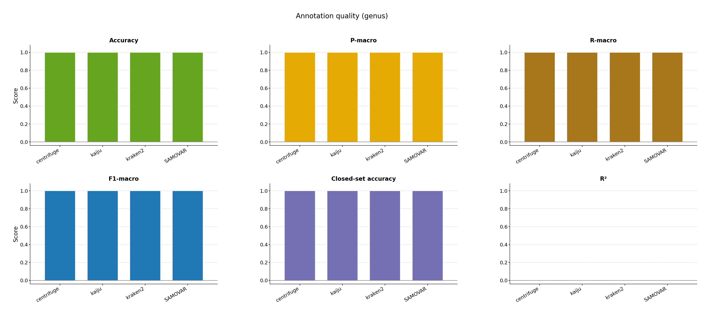

# Benchmark

Four de novo phage indexes (Kraken2, Kaiju, Centrifuge, Kraken2+Bracken) and one `--mode benchmark` package: three generate repeats of one sample. MetaX is not built; `samovar build` has no `metax` type.

```bash
bash examples/benchmark/pipeline.sh
```

The package report is the repeat summary: one point per repeat, the mean and its interval, and composition. Each child also keeps its own score bar. Benchmark mode does not write the single-run F1 heatmap.




[multiqc/multiqc_report.html](multiqc/multiqc_report.html)

The full run tree stays in `examples_outdir/benchmark/`. Databases stay in `examples_outdir/benchmark_db/`.
