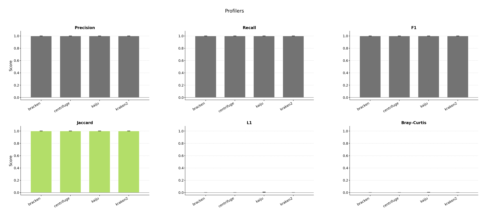

# Benchmark

Four de novo phage indexes (Kraken2, Kaiju, Centrifuge, Kraken2+Bracken) and one `--mode benchmark` package: three generate repeats of one sample. Kaiju is built from each phage's protein FASTA (`*.faa`). Kraken2, Centrifuge, and Bracken use the nucleotide genomes. MetaX is not built; `samovar build` has no `metax` type.

```bash
bash examples/benchmark/pipeline.sh
```

The package summary writes `summary/figures/annotators.png` and, when a profiler ran, `summary/figures/profilers.png`. Each file is one bar chart of the mean across repeats with the 95% interval. These charts are not part of the MultiQC report.

The package MultiQC report uses the same idea for its own score sections: one bar chart per scale, with the 95% interval as a whisker and plain titles. Alpha and beta diversity are left out when the package has fewer than two samples, unless those sections were requested. Bracken's reported time and peak memory are the Kraken2 classification plus the Bracken step.




[multiqc/multiqc_report.html](multiqc/multiqc_report.html)

The full run tree stays in `examples_outdir/benchmark/`. Databases stay in `examples_outdir/benchmark_db/`.
Its `--reindex 1` generation step keeps the selected processed phage assemblies
in the shared SAMOVAR Database and records their canonical paths; it does not
copy them into each repeat run.
