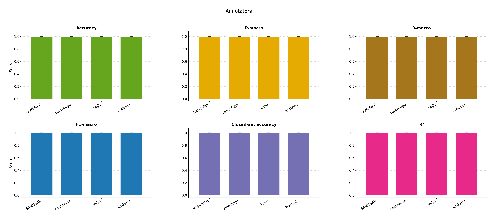

# Benchmark

Four de novo phage indexes (Kraken2, Kaiju, Centrifuge, Kraken2+Bracken) and one `--mode benchmark` package: three generate repeats of one sample. MetaX is not built; `samovar build` has no `metax` type.

```bash
bash examples/benchmark/pipeline.sh
```

The package summary writes `summary/figures/annotators.png` and, when a profiler ran, `summary/figures/profilers.png`. Each file is one bar chart of the mean across repeats with the 95% interval. These charts are not part of the MultiQC report.




[multiqc/multiqc_report.html](multiqc/multiqc_report.html)

The full run tree stays in `examples_outdir/benchmark/`. Databases stay in `examples_outdir/benchmark_db/`.
