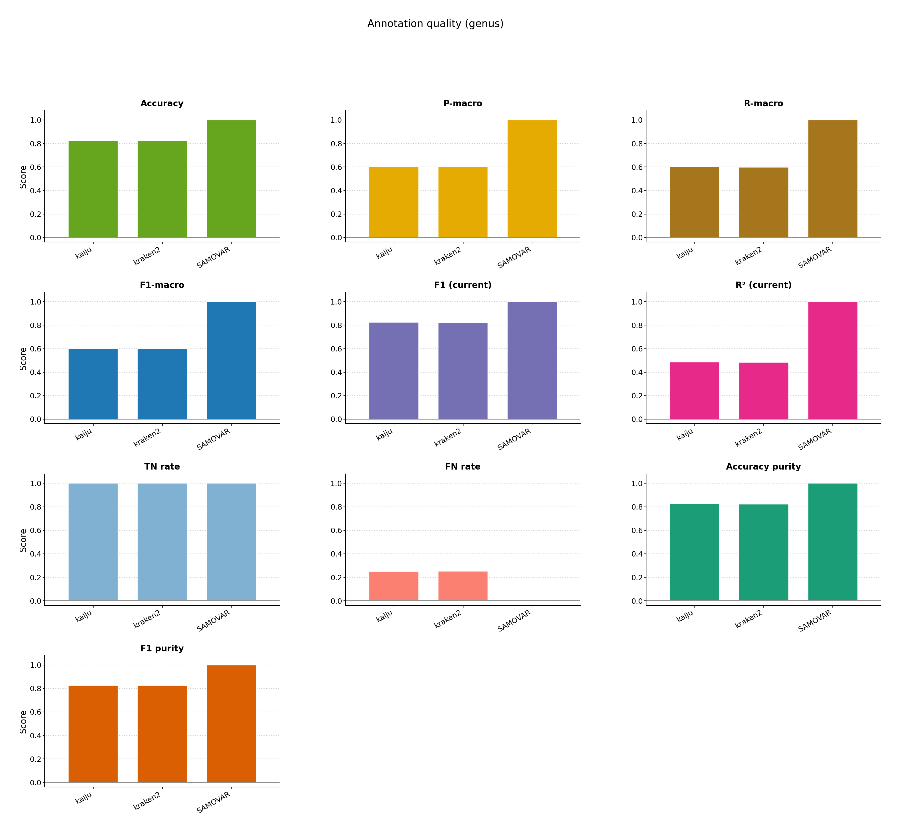
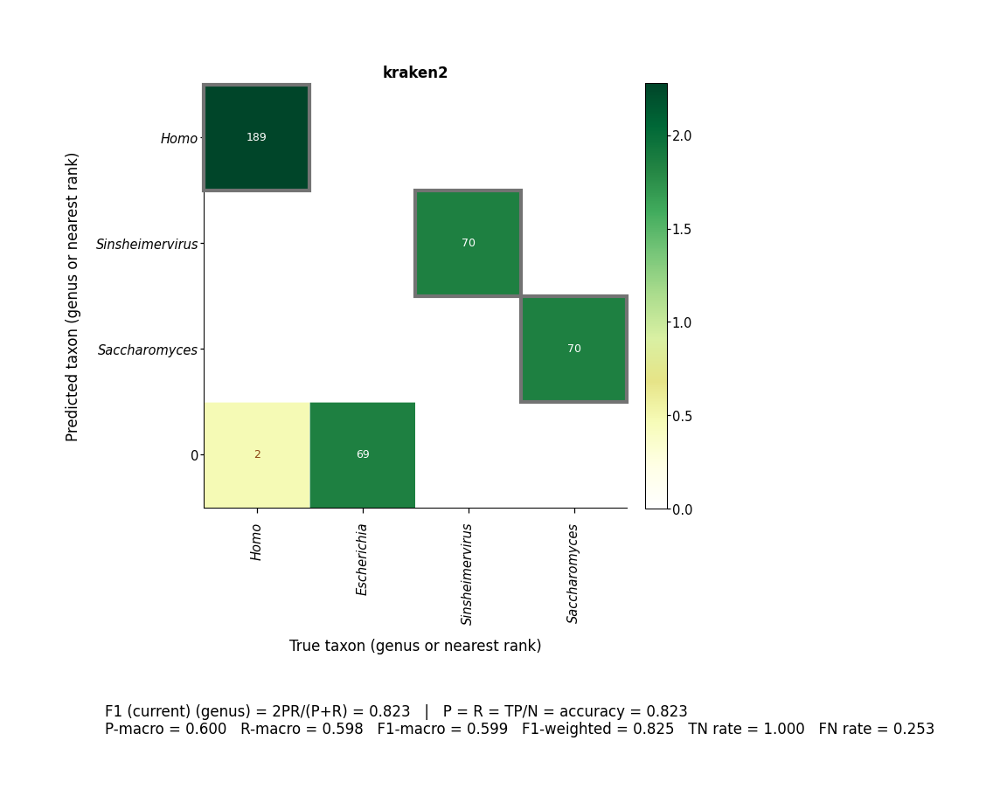

# Scoring

Compare annotators on the same reads (Kraken2 vs Kaiju) and import a small custom scorer.

```bash
bash examples/scoring/pipeline.sh
```





[multiqc/multiqc_report.html](multiqc/multiqc_report.html)

`run/initial_annotations_plots/quality_scores.csv` is a harvested legacy table, not a fresh check of the current scorer. No seed or package version is stored in it. Its `f1` column matches `accuracy` (closed-set TP/N); `opal_f1` is a different, older profile number. New reports use `schema=read-quality-v1` and do not recalculate this file.
